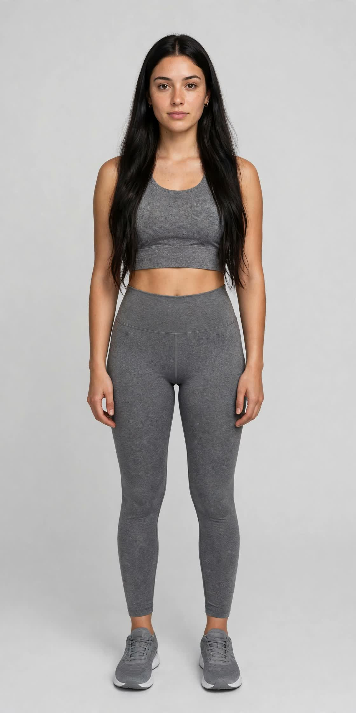
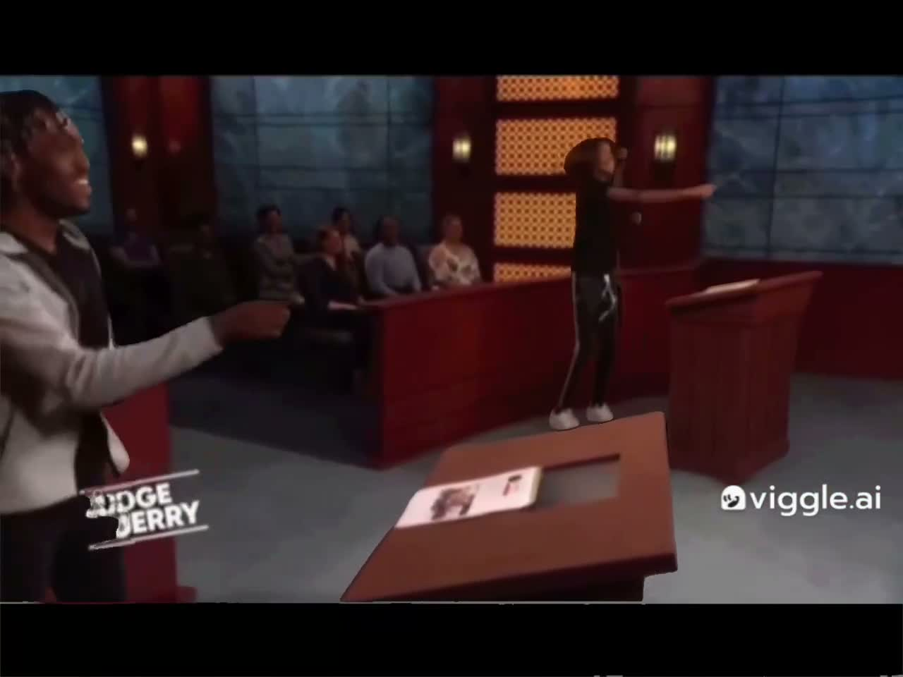
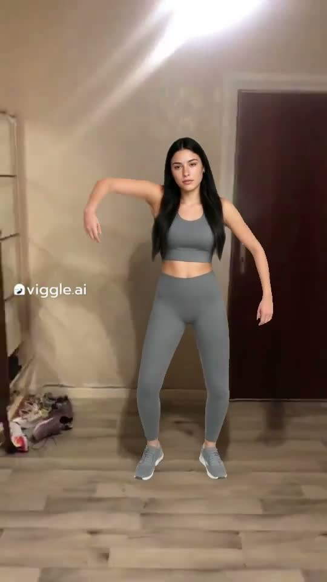
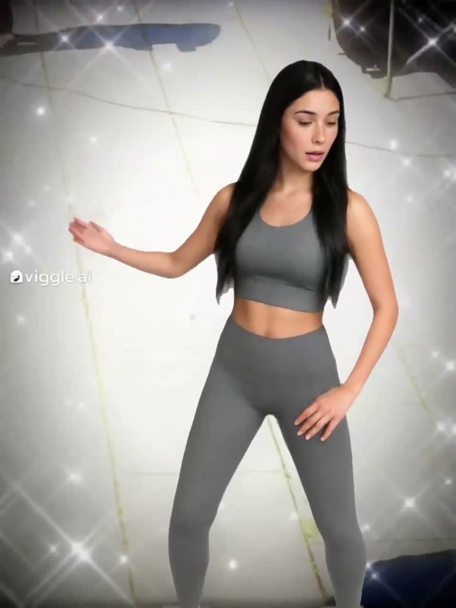

# 求助：Viggle 免费档怎么做出慢而优雅的单人舞？

目标风格：慢、优雅、柔和，身姿挺拔，手臂缓慢柔和摆动，不要快节奏、不要大开大合、不要含胸。参考视频：https://x.com/sandmrk/status/2115312587483336971/video/1

我用的方法：Viggle 免费档 Mix，上传了一张 AI 生成的全身参考照（长发、灰色运动装），单人竖屏。

参考造型：

已经试过三个模板，效果都不行：
1. Jerry Springer TikTok dance：出来是双人法庭 meme，还带原节目的人和标志，不能用。

2. Spanish danceee：单人是单人，但舞姿手臂大抡、含胸前探，像猩猩，不好看。

3. dancing with joy：姿态倒是挺拔柔和，但动作太平、太素，没有参考视频那种味道。

求问大神：免费档里有没有更接近目标风格的模板？或者 Mix 的时候有什么参数、提示词、选图技巧能改善？只求指点方法，免费方案，谢谢！
